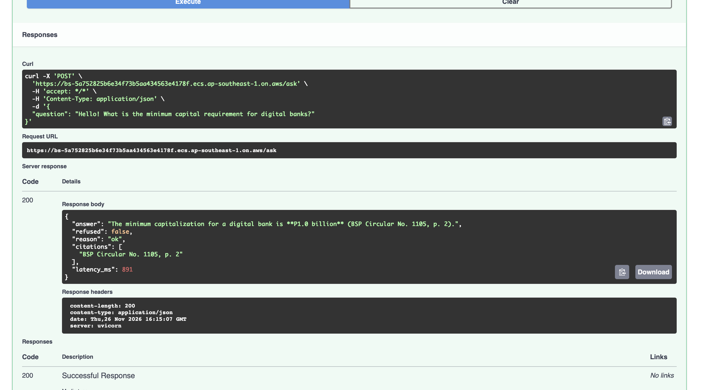
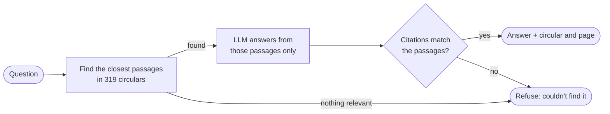

# BSP Circular Copilot


**Try it:** [ellegaza.com/bsp-chatbot](https://ellegaza.com/bsp-chatbot).

An AI assistant for Philippine banking regulations. Ask a question about the Bangko Sentral ng
Pilipinas (BSP) circulars and it answers **with the circular number and page it came from**,
or says it couldn't find it. It never answers from memory.

```
Q: What is the minimum capital requirement for digital banks?
A: The minimum capitalization for a digital bank is P1.0 billion (BSP Circular No. 1105, p. 2).
```



## Why

In banking compliance, a confident wrong answer is worse than no answer. General chatbots can
invent rules or circular numbers. This one only answers from the circulars, shows where each
answer came from so it can be checked, and refuses when it has no source.

## How it works



1. **Read the circulars.** 319 BSP circulars (PDFs) are split into small passages, page by page,
   and stored in a database that can search by meaning (Postgres + pgvector).
2. **Find the right passages.** A question is matched to the most relevant passages.
3. **Answer from them only.** An LLM writes the answer using just those passages, citing
   circular and page.
4. **Check before replying.** Code checks that every citation points to a passage the model was
   actually given. No source, or a made-up citation, means it refuses.

## Results

A set of 14 hand-checked questions measures whether it answers when it should and refuses when
it should. On the first baseline it made the right call on 10 of 14, and every answer it gave
cited the correct circular. When it couldn't find the source, it refused rather than guessed.

## Deployment

Runs as a Docker container on **Amazon ECS (Fargate)** with secrets in **AWS Secrets Manager**
and logs in **CloudWatch**. It's switched on for demos and off afterwards to keep costs near
zero. GitHub Actions tests and builds every change. Details: [`deploy/README.md`](deploy/README.md).

## Built with

Python · FastAPI · LangChain / LangGraph · Postgres + pgvector (Supabase) · Groq · Ollama ·
Docker · GitHub Actions · AWS (ECS Fargate, ECR, Secrets Manager, CloudWatch)

## Next

A Databricks data pipeline that cleans and checks the circular data, better search for long
documents, and text recognition (OCR) for 22 scanned circulars.

*Not legal advice. Check answers against the original circular on bsp.gov.ph.*
